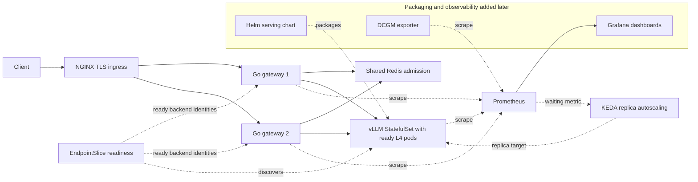
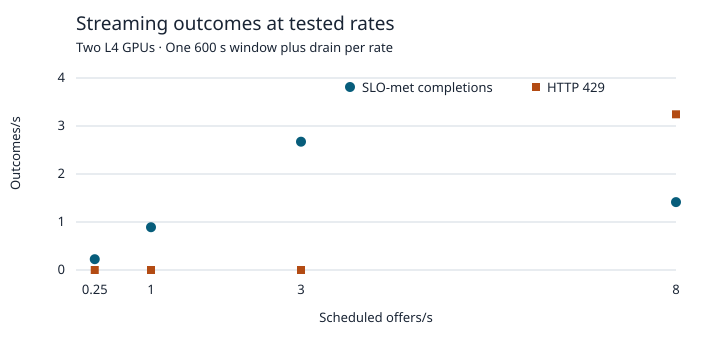
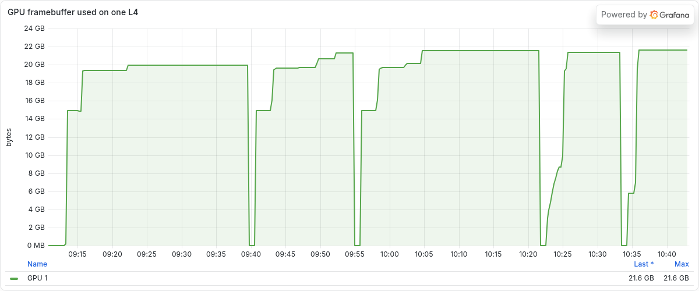
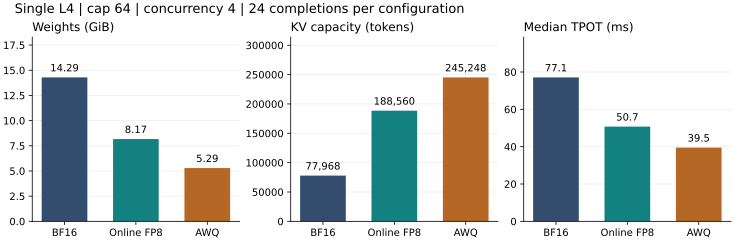
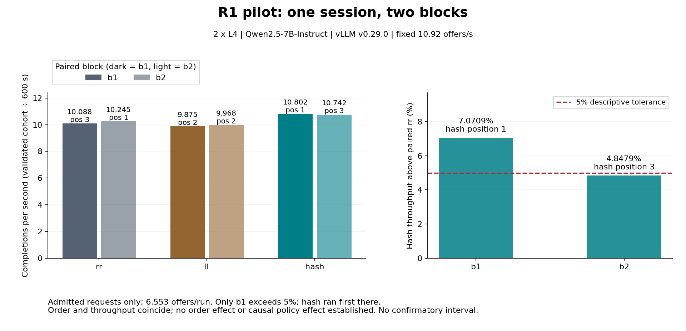
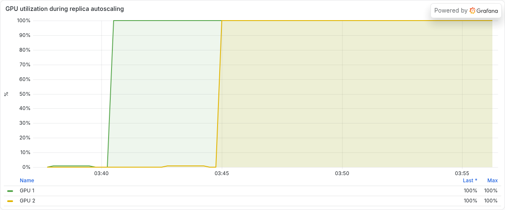

# Multi-Tenant LLM Inference Gateway on AWS EKS

A Go gateway shares tenant limits across replicas and streams model responses from GPUs on AWS EKS.

## Headline results

The latency service-level objective (SLO) requires first content within 1 s and
validated completion within 15 s of dispatch. Ordinary requests are offers
outside the assigned cancellation cohort.

| Result | Conditions | Evidence |
| --- | --- | --- |
| **All 1,620 ordinary requests met both latency targets at 3 offered req/s on two L4s.** The run delivered 92.9 output tokens/s/GPU at an estimated $2.41 per million output tokens on the GPU-node-time basis. | One EKS run, Qwen2.5-7B-Instruct, 600 s plus drain, 10% assigned cancels | [Capacity and cost](experiments/capacity-cost/README.md) |
| **At 8 offered req/s, the gateway rejected 41% of offers in a median 5.9 ms.** Only 863 of 4,320 ordinary requests met both latency targets. | Same run and window method. Both engines reached their 16-sequence ceiling. | [Streaming results](experiments/streaming-eks/README.md) |
| **On one L4 at concurrency 4, median time per output token was 77.1 ms for BF16, 50.7 ms for FP8 and 39.5 ms for AWQ.** | Client concurrency 4, sequence cap 64, 24 completions per configuration. With warm-up carryover, peak engine running counts were 4, 29 and 32, respectively. | [Single-L4 results](experiments/single-l4/README.md) |
| **The gateway added 2.5–3.0 ms to median stream completion at 1,600 offered req/s on a CPU testbed.** | Three paired direct/gateway blocks with two native gateways, Redis and a fake backend on one Windows CPU testbed | [CPU profiling](experiments/inf036/README.md) |

## Architecture



The tenant cache salt is derived when tenant policy loads. The gateway
authenticates the tenant and checks input and output limits. Redis atomically
grants rate and concurrency capacity across gateway replicas. EndpointSlice
readiness identifies eligible vLLM replicas and their generations. The gateway
selects one upstream and validates its first SSE item before committing the response.
It attempts reservation release on completion, cancellation or failure, with lease
expiry as the fallback.

## What's built

| Component | What it does | Where |
| --- | --- | --- |
| Shared admission | Redis Lua enforces rate, concurrency, global and healthy-replica bounds. Leases recover lost reservations. Store failure closes admission. | [Admission](internal/admission) |
| Streaming | One upstream attempt, validation before response commit, cancellation propagation and bounded drain. | [Gateway](internal/gateway/handler.go) |
| Routing | Round robin, least loaded and rendezvous prefix affinity with load escape. | [Gateway routing](internal/gateway) |
| Tenant cache salts | HMAC-derived salts separate reuse keys by tenant. | [Routing key](internal/gateway/routing_key.go) |
| Tenant API keys | Tenant-scoped hashed keys and revocation, with model and quota policy. | [Tenant configuration](internal/gateway/tenant.go) |
| Usage metering | Optional Redis token ledger with durable admission, recovery, corrections and reconciliation. | [Metering](internal/admission/metering.go) |
| Infrastructure | Terraform for EC2 GPU pilots and the two-L4 EKS deployment. | [Terraform](infra/terraform) |
| Serving package | Helm chart with optional KEDA replica ownership and DCGM. | [Chart](deploy/helm/inference-platform) |
| Observability | Prometheus metrics, OpenTelemetry traces, Grafana provisioning and DCGM GPU metrics. | [Observability](deploy/observability) |
| CI | Go and Python checks, frozen evidence validation and CPU integration fixtures. | [Workflow](.github/workflows/ci.yml) |

## Results

### EKS streaming and unit cost

One ordered run on two fixed L4s tested 0.25, 1, 3 and 8 offered requests/s.
The 3 req/s point is the highest tested rate with full ordinary-request attainment.
Cost estimates give both GPU-node time and a full-session allocation.

| Offered req/s | SLO completions/s | HTTP 429/s | Output tokens/s/GPU | Estimated GPU-node $/1M | Estimated full-session $/1M |
| ---: | ---: | ---: | ---: | ---: | ---: |
| 0.25 | 0.225 | 0.000 | 7.832 | 28.54 | 487.29 |
| 1 | 0.891 | 0.000 | 30.862 | 7.24 | 123.67 |
| 3 | 2.673 | 0.000 | 92.924 | 2.41 | 41.07 |
| 8 | 1.414 | 3.244 | 141.478 | 1.58 | 26.98 |

All 526 sent cancels matched a vLLM frontend abort record.
[Workload and frozen rows](experiments/streaming-eks/README.md) |
[Capacity table and cost basis](experiments/capacity-cost/README.md)



### Single-L4 tuning and quantization

The BF16 sweep used sequence caps 16, 32 and 64. At 6 offered req/s, the
client dispatched 2.27, 2.67 and 2.95 req/s, respectively. The matched trace
used client concurrency 4. With warm-up carryover, peak engine running
counts were 4 for BF16, 29 for online FP8 and 32 for official AWQ.
The greedy GSM8K check uses strict format-and-answer scoring. Invalid-format
shares were 77%, 71% and 30% of 1,319 items for BF16, FP8 and AWQ, respectively.




[Configurations, timings and quality rows](experiments/single-l4/README.md)

### Noisy-neighbor quota

On the same BF16 L4 at a 16-sequence cap, B completed 62/120 offers with A's quota active
and 8/120 with that quota lifted under the matched flood. In a separate comparison,
tenant B’s p95 time to first token over completed streams was 7.45 s under
the flood with the quota active (n = 62) and 0.44 s with no neighbor (n = 96).
In the tenant-A-at-quota arm, B completed 60/120 offers and 6/120 met the SLO.
[Arms and terminal counts](experiments/single-l4/README.md#victim-tenant-under-contention)

### Deployment and pod replacement

One separate EKS run on two fixed L4s exercised a gateway rolling restart and a vLLM pod replacement.
The short-output engine replacement window completed 7,892/7,894 offers, with two admission-unknown outcomes.
The endpoint and readiness clocks are retained with the run conditions.
[Deployment and rollout](experiments/streaming-eks/deployment.md)

### CPU overhead and pprof

The two-gateway CPU testbed paired gateway and direct mock streams through a pinned Redis setup.
pprof snapshots were captured separately from the unprofiled latency comparisons.
Only the reported paired load point supports the headline overhead.
[Protocol, overhead and profiles](experiments/inf036/README.md)

### Routing pilot

One two-L4 session compared three routing policies across two blocks with different orders.
The order is confounded with the measured difference, so the comparison is descriptive.


[Pilot conditions and chart](experiments/r1/README.md)

### KEDA autoscaling

KEDA scaled vLLM from one to two replicas on two fixed L4 nodes.
In one session with three cycles per arm, 2.67% of 8,280 scheduled offers met
the SLO with fixed-1, 78.86% with KEDA and 100% with fixed-2. The 1-minute
baseline is included. The second replica first completed a request 194–210 s
after burst onset. GPU node count stayed fixed.



[Autoscaling results and conditions](experiments/autoscaling/README.md)

## How results are checked

Workloads, populations and pass rules are pre-registered.
Frozen rows and checksums support independent recounts.
Code and public claims are independently reviewed.
Cloud runs end with verified teardown and a separate inventory.

## Limitations

- The streaming and tuning results each cover one run with their exact model, runtime and load conditions.
- Each GPU test used a single availability zone, with no cross-zone capacity inference.
- The routing comparison is a pilot with order confounding.
- The GPU nodes stay fixed and billed when replica count changes.
- Cache isolation was shown by a direct probe. The routing pilot uses a single tenant.
- Cancellation joins measure vLLM frontend abort submission. Per-request scheduler and KV release remain unmeasured.
- CPU overhead includes Redis and the tested gateway path on the local fake-backend workload.

## Quickstart

From the repository root on a clean checkout, install Go 1.26, Python 3.12 through uv,
a running Linux-container Docker engine, and curl 7.76 or later. The pinned tokenizer fetch uses the network.
The demo then runs Redis, the CPU fake backend and a native Go gateway on loopback.
It sends one authenticated streaming curl and cleans up its processes and Redis container.

```sh
uv run --project python --locked python -m inference_platform.stage_c_tokenizer --fetch --fetch-only
uv run --project python --locked python scripts/cpu_quickstart.py
```

The stream ends with:

```text
data: [DONE]
```

[Demo runner](scripts/cpu_quickstart.py) | [Manual local setup](deploy/local/README.md)

## Repository map

| Directory | Contents |
| --- | --- |
| [cmd](cmd) | Go service entry points |
| [internal](internal) | Gateway, admission and runtime implementation |
| [python](python) | Fake backends, workload clients and analysis |
| [deploy](deploy) | Local, Kubernetes, Helm and observability configuration |
| [infra](infra) | Terraform and provider wiring |
| [experiments](experiments) | Reviewed results and frozen rows |
| [scripts](scripts) | Demos, validation and operators |
| [.github](.github) | CI workflow |

## Related systems

llm-d documents Kubernetes-native serving and routing. SGLang documents a model-serving runtime.
This project measures its own gateway and pinned vLLM configurations. The results establish no comparative ranking.
[Version-pinned references](experiments/related-systems.md)

## License

[MIT](LICENSE)
