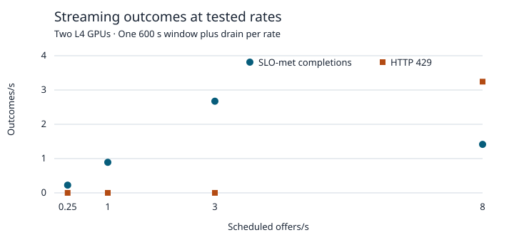

# Capacity and cost at the tested rates

This recount uses the [two-L4 streaming run](../streaming-eks/README.md).
The latency SLO is first content within 1 s and validated completion
within 15 s. Per-second rates use each 600 s offer window plus measured
drain. The GPU-only estimate charges both On-Demand g6.xlarge nodes
at USD 0.8048/hour each for that time. Output includes every validated
completion. The full-session allocation distributes the USD 18.49
estimate by observed window-and-drain time.

| Offered req/s | SLO completions/s | HTTP 429/s | Output tokens/s/GPU | Estimated GPU-node $/1M | Estimated full-session $/1M |
| ---: | ---: | ---: | ---: | ---: | ---: |
| 0.25 | 0.225 | 0.000 | 7.832 | 28.54 | 487.29 |
| 1 | 0.891 | 0.000 | 30.862 | 7.24 | 123.67 |
| 3 | 2.673 | 0.000 | 92.924 | 2.41 | 41.07 |
| 8 | 1.414 | 3.244 | 141.478 | 1.58 | 26.98 |

3 req/s was the highest tested rate at which every ordinary scheduled
request met both latency thresholds. Assigned cancels stay in their
own cohort. The estimates describe one run at each tested rate.

[Frozen request rows](../streaming-eks/requests.jsonl.gz)
[Artifact checksums](SHA256SUMS)
