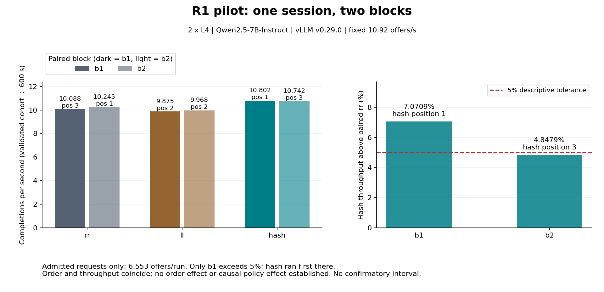

# Routing pilot on two L4s



Conditions: 2× g6.xlarge / one L4 each, Qwen2.5-7B-Instruct, vLLM v0.29.0, fixed open-loop 10.92 offers/s and 6,553 offers/run. One synthetic tenant/salt domain; 384 independent 1,024-token prefixes, 96 hot receive 80% of potential references, maximum one output token. Each policy warmed for 600 s then measured for 600 s; all reached maximum warm-up and remained valid-unstable.

Request-result scope: admitted requests only. Throughput is validated cohort completions / fixed 600 seconds, including drain completions. HTTP 429 counts use offered denominators. Each run missed one offer; no admitted failures/censoring. Orders: hash/ll/rr in b1, rr/ll/hash in b2. Hash completed 428 and 298 more requests than paired rr, exactly matching fewer 429s. Hash throughput was 7.0709% above rr in b1 and 4.8479% in b2; only b1 exceeded the 5% descriptive tolerance, where hash ran first. The line is not a significance threshold. Throughput and order coincide in these two blocks; neither an order effect nor a causal policy effect is established. No confirmatory interval or general routing-superiority claim.

Aggregate native token-hit fractions for hash were 0.540/0.551 in b1 and 0.532/0.549 in b2 across replicas; ll positive joint-wait sample fractions (any request waiting across both replicas) were 508/1200 and 463/1200. These give descriptive aggregate counter/sampled-window context, not per-request hit probability, cache usage or eviction evidence.

[chart-data.json](chart-data.json) is a deterministic projection of the reviewed private analysis receipt, bound to its original full commit/path/SHA-256; it contains all six run counts, throughput denominators, paired comparisons and order. Original hardware measurement is not rerun by chart reproduction.

```powershell
uv run --locked --script scripts/render_r1_packet.py --output-dir .cache/r1-chart
```

Run from the repository root. In the private source the renderer reads the hash-pinned committed analysis; in the public snapshot it verifies this exact projection hash. Matplotlib is pinned in the adjacent script lock. [SHA256SUMS](SHA256SUMS) binds this README, chart and projection. No TTFT figure is part of this packet. The result establishes no stable production capacity, tenant isolation, SLO/goodput, cost efficiency, EKS performance, emulator accuracy, exact realized pressure or complete instrumentation.
