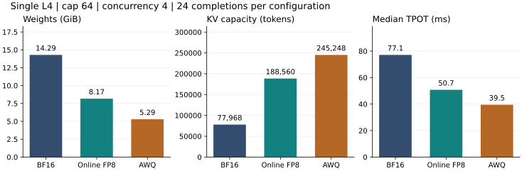

# Single-L4 serving and quantization

One EC2 g6.xlarge in us-east-1d ran Qwen2.5-7B-Instruct on vLLM
0.29.0. The BF16 and online FP8 model revision was
`a09a35458c702b33eeacc393d103063234e8bc28`. Official AWQ used
`b25037543e9394b818fdfca67ab2a00ecc7dd641`. The KV dtype was
BF16 in every start. The engine read back Cutlass W8A8 FP8 and
AWQ Marlin kernels.

| Configuration, sequence cap 64 | Weight GiB | KV tokens | Median TPOT, ms |
| --- | ---: | ---: | ---: |
| BF16 | 14.29 | 77,968 | 77.1 |
| Online FP8 | 8.17 | 188,560 | 50.7 |
| AWQ | 5.29 | 245,248 | 39.5 |

Each cell validated all 24 offers with client concurrency 4,
6,144-token inputs and a 128-token cap. With warm-up carryover,
peak engine running counts were 4 for BF16, 29 for FP8 and 32 for AWQ. Concurrency-64 cells
had missed offers and transport errors. The BF16 sequence-cap sweep
at 6 offered req/s recorded 160.6, 218.8 and 274.6 output tokens/s
for caps 16, 32 and 64 with 1,024-token inputs. The client dispatched
2.27, 2.67 and 2.95 req/s, respectively. Queueing and incomplete
offers limit that comparison. This compares three concrete configurations
with different checkpoints and kernels. It establishes no bit-width
effect or quality equivalence.

[BF16 rows](bf16-64-b-4.json) |
[FP8 rows](fp8-64-b-4.json) |
[AWQ rows](awq-64-b-4.json) |
[BF16-16 sweep](bf16-16-a-6.json) |
[BF16-32 sweep](bf16-32-a-6.json) |
[BF16-64 sweep](bf16-64-a-6.json) |
[Recount](recount.json) |
[Carryover and dispatch readback](review-recount.json)

## Victim tenant under contention

On the same L4 at BF16 cap 16, with a 20-slot global bound, tenant B
scheduled 120 offers per arm. During the matched flood, B completed
62/120 offers with A's quota active and 8/120 with that quota lifted.
The p95 TTFT over B's completed streams was 7.45 s with the flood
and quota active (n = 62) and 0.44 s with no neighbor (n = 96).
SLO completions in those arms were 8/120 and 96/120. In the
[tenant-A-at-quota arm](bf16-16-c-a_at_quota.json), B completed
60/120 offers and 6/120 met the SLO.

[Quota on](bf16-16-c-a_flood_quota.json) |
[Quota lifted](bf16-16-c-a_flood_lifted.json) |
[B alone](bf16-16-c-b_alone.json)

## Quality check

Greedy decoding used 1,319 fixed GSM8K items with a 512-token cap.
The scorer required a strict final-line number format. Exact
format-and-answer counts were 160 (BF16, repeated), 210 (FP8) and
167 (AWQ). Invalid-format shares were 77%, 71% and 30% of the
1,319 items for BF16, FP8 and AWQ, respectively. These counts cover
the fixed item set and strict scoring rule.

[BF16](quality-bf16-first.json) |
[Repeat](quality-bf16-repeat.json) |
[FP8](quality-fp8.json) |
[AWQ](quality-awq.json) |
[Artifact checksums](SHA256SUMS)
